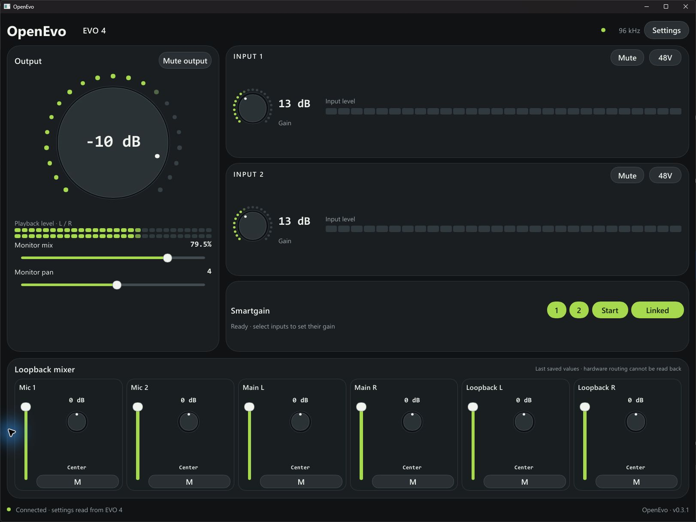

# OpenEvo

A modern, lightweight, open-source control app for the **Audient EVO 4 on Windows**.
One native window for your inputs, monitoring and loopback mixer, with a charcoal
and lime interface inspired by the hardware.

[Download the latest Windows release](https://github.com/saikhurana98/OpenEvo/releases/latest)



## What it does

- Input gain, mute, two-step 48V activation, stereo link and Smartgain.
- Output volume/mute, direct-monitor mix and monitor pan.
- Six loopback sources, each with a level fader, pan and mute.
- Live input and stereo playback meters with smooth attack, hold and release.
- Sample-rate and ASIO-buffer settings from the installed driver.
- A dense, responsive console that fits half- and third-height portrait snaps.
  Controls shrink before sections collapse, and return when space is available.

Built with Rust and Slint. No webview, server, account or replacement audio driver.

## Install

1. Install the official Audient Windows driver and connect one EVO 4.
2. Download `OpenEvo-0.3.1-windows-x64.zip` from [Releases](https://github.com/saikhurana98/OpenEvo/releases).
3. Extract the ZIP and run `OpenEvo.exe`.

The portable ZIP includes application source, build instructions and a SHA-256
manifest. This release is unsigned. Audient's driver and firmware are not bundled.

## Compatibility and limits

This release supports Windows x64 and the tested EVO 4 API DLL, file version
**5.70.0.0**, SHA-256
`25af306d32bb674796bfe82ba220396254d97e8859e024394fbeda7db242b2e6`.
Other DLL builds and Audient models are rejected until their contracts are verified.

Loopback routing is write-only: the app displays saved intent and never claims
hardware route readback. Launching or reconnecting does not replay cached routes.
The master ring measures main playback activity; it is not an analog output meter.
Use Audient's official updater for firmware. Rate/buffer changes can restart audio.

See [usage and build details](NATIVE_README.md),
[verification and known limits](RELEASE_STATUS.md), and [protocol notes](PROTOCOL.md).

## Build and test

Install Rust and Visual Studio Build Tools with the Desktop development with C++
workload and Windows SDK. The toolchain and dependency lockfile are checked in.

```powershell
powershell -NoProfile -ExecutionPolicy Bypass -File tools/build.ps1 -Configuration release -Test
powershell -NoProfile -ExecutionPolicy Bypass -File tools/package.ps1 -Version 0.3.1
```

The executable is `target/release/openevo.exe`; the portable ZIP is in `dist/`.
Automated tests run without an EVO 4. The separate interactive UI regression is
ignored by default and uses simulated state without loading the hardware driver.

Earlier device tests covered control readback, Smartgain, all six mixer sources,
physical knob sync, USB reconnect and bounded ASIO/WASAPI coexistence. Those
measurements do not establish analog click-free output or hours-long stability.
Reviewed UI-only results are in [docs/validation](docs/validation); raw local
recordings and reverse-engineering dumps are excluded from the repository.

## License and credits

[GPL-3.0-only](LICENSE). See [third-party notices](THIRD_PARTY_NOTICES.md).
OpenEvo is independent software and is not affiliated with or endorsed by Audient.
Audient and EVO belong to their respective owners.
